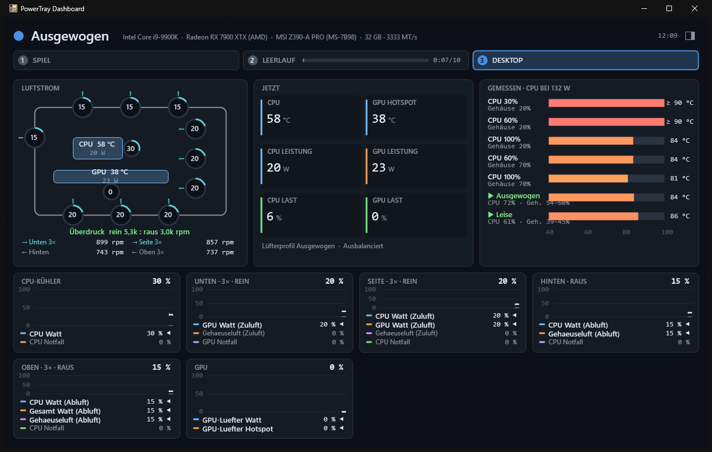

# PowerTray

Ein Tray-Icon für Windows, das **Energieplan und Lüfterkurve gemeinsam** umschaltet: Mausrad über dem Icon hoch = mehr
Leistung, runter = leiser. Dazu gibt es ein **FanControl-Plugin**, mit dem Lüfter nach Leistungsaufnahme (Watt) statt
nur nach Temperatur geregelt werden.

*A Windows tray icon that switches power plan and fan profile together. Scroll over the icon to change profiles.
UI is German or English depending on your Windows language.*



## Funktionen

- **Automatik:** Steam-Spiel läuft → *Leistung*, 10 min keine Eingabe → *Leise*, sonst *Ausgewogen*.
  Manuell gewählt gilt bis zum nächsten Zustandswechsel. Spiele außerhalb von Steam per Exe-Name ergänzbar.
- **Dashboard** (Tray-Menü oder Startmenü → *PowerTray Dashboard*; F11 = Vollbild; Knopf oben rechts dockt es schmal
  an den Bildschirmrand): dein PC als Modell mit jedem Lüfter (% und RPM), CPU/GPU-Temperatur und Watt, Über-/Unterdruck,
  die Automatik-Regeln 1-2-3, pro Lüftergruppe die Überlagerung aller FanControl-Kurven (welche gerade bestimmt) und
  Messergebnisse aus der Optimier-Session. Neu gezeichnet nur alle 2 s und nur, wenn sichtbar.
- **Spiel beenden:** hängt ein Steam-Spiel, beendet ein Knopf im Dashboard bzw. Tray-Menü alle Prozesse aus `steamapps\common`.
- **Beliebige Gehäuse-Layouts** inkl. AIO; Werkzeuge zum Erkennen der Lüfter, Messen und Erzeugen der Profile (für KI-Agenten gebaut).
- Profile aus Energieplan + [FanControl](https://getfancontrol.com)-Konfiguration, beliebig viele (bis 9)
- Mausrad über dem Icon, Klick öffnet das Menü; das Icon zeigt das aktive Profil als Balken
- Wird der Plan woanders gewechselt (Windows-Einstellungen, Spiel-Launcher), zieht PowerTray die Lüfterkurve nach
- Wächter: startet FanControl neu, falls es abstürzt
- Richtet sich beim ersten Start selbst ein (Profile aus vorhandenen Energieplänen, FanControl wird automatisch gefunden)
- Läuft auch ohne FanControl (dann nur Energiepläne)
- Plugin **WattSensors**: CPU-Watt (Intel/AMD über Windows Energy Meter), GPU-Watt (AMD und NVIDIA), CPU+GPU-Summe, geglättet
- Keine Installation von .NET nötig, keine Adminrechte für die App

## Installation

1. [Release-ZIP](../../releases/latest) herunterladen und entpacken
2. `install.cmd` doppelklicken

Der Installer kopiert PowerTray nach `%LOCALAPPDATA%\Programs\PowerTray`, richtet den Autostart ein, bietet die
Installation von FanControl (über winget) an und legt das Plugin in den FanControl-Plugin-Ordner (einmal UAC bestätigen).

Optionen: `install.ps1 -Component App|Plugin`, `-Yes` (ohne Rückfragen), `-NoFanControl`, `-NoAutostart`.
Entfernen: über *Einstellungen → Apps* oder `uninstall.ps1`.

## Einrichtung mit Claude oder ChatGPT

Die Lüfterkurven hängen von deinem PC ab. Lass dir von einer KI helfen – das Repo enthält mit [AGENTS.md](AGENTS.md)
eine Schritt-für-Schritt-Anleitung für KI-Agenten.

- **Claude Code / Codex:** Repo klonen, im Ordner starten und schreiben: *„Richte PowerTray auf meinem PC ein.“*
- **Claude.ai / ChatGPT (Chat):** Folgendes einfügen:
  > Lies https://github.com/vsvito420/PowerTray/blob/main/AGENTS.md und hilf mir Schritt für Schritt, PowerTray auf
  > meinem Windows-PC einzurichten. Gib mir die PowerShell-Befehle einzeln, ich schicke dir die Ausgaben.

## Einstellungen

`PowerTray.ini` (Tray-Menü → *Einstellungen bearbeiten*):

```ini
[Profil1]
Name=Leise
Plan=a1841308-3541-4fab-bc81-f71556f20b4a   ; GUID aus "powercfg /list"
FanConfig=Leise.json                         ; in FanControl gespeicherte Konfiguration, leer = Lüfter nicht schalten
Farbe=#3CB371
```

```ini
[Automatik]
Aktiv=1
IdleMinuten=10
ProfilSpiel=3          ; Nummer aus [ProfilN]
ProfilIdle=1
ProfilDesktop=2
SpielExe=              ; z. B. FortniteClient-Win64-Shipping,LeagueClient
SteamIgnorieren=431960 ; Steam-Apps, die kein Spiel sind (Wallpaper Engine)
```

```ini
[Gehaeuse]            ; LuefterN=Position|FanControl-NickName|Anzahl|rein/raus|Radiator
Luefter1=CPU|Fan #2 CPU|1
Luefter2=Vorne|Fan #6|3|rein
Luefter3=Oben|Fan #7|3|raus|Radiator
Luefter4=Hinten|Fan #3|1|raus
Luefter5=GPU|Control 1 - AMD Radeon RX 7900 XTX|1
```

Plugin: `FanControl.WattSensors.ini` im FanControl-Plugin-Ordner (`CpuMaxWatt`, `GpuMaxWatt`, `SmoothingSeconds`,
`GpuPowerSensorIndex`). Details in [AGENTS.md](AGENTS.md#3-plugin-anpassen).

Jedes Gehäuse-Layout geht: Front, Top, Boden, Seite, Rückseite, AIO-Radiatoren, beliebige Richtungen und mehrere Gruppen
pro Position. Beispiele und der komplette Ablauf stehen in [AGENTS.md](AGENTS.md#5-gehäuse-layout-erfassen).

## Werkzeuge (`tools\`)

| Skript | Zweck |
|---|---|
| `Detect-Fans.ps1` | findet belegte Lüfteranschlüsse; `-Only <Name>` dreht einen hoch, um ihn im Gehäuse zu finden |
| `Make-FanProfiles.ps1` | erzeugt Leise/Ausgewogen/Leistung/Turbo aus Layout + Sensoren (mit Backup, `-WhatIf` zum Ansehen) |
| `Measure-Cooling.ps1` | misst unter CPU-Last, wie viel CPU- und Gehäuselüfter wirklich bringen |
| `Test-Profile.ps1` | prüft ein Profil unter Last |

Alle brauchen das WattSensors-Plugin mit `LiveDaten=1` und stellen am Ende das vorherige Profil wieder her.

## Selbst bauen

```powershell
powershell -File build.ps1
```

Nutzt den in Windows enthaltenen C#-Compiler. Für das Plugin muss FanControl installiert sein (`FanControl.Plugins.dll`).

## Lizenz

MIT. FanControl ist ein eigenständiges Projekt von Rem0o und nicht Teil dieses Repos.
